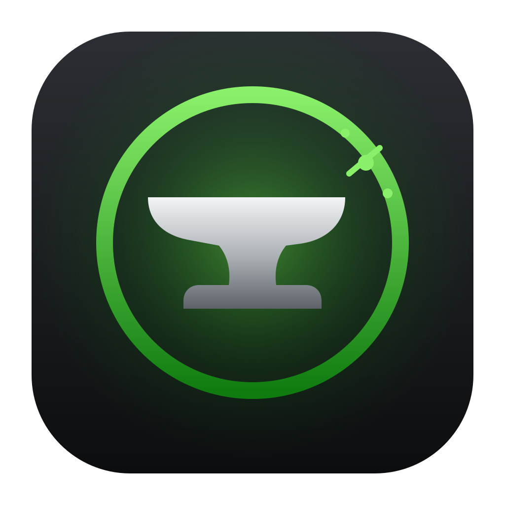

# EliteForge

Configure an Xbox Elite Wireless Controller Series 2 from a Mac. It's a native macOS app (SwiftUI) that reads and writes the three profile slots stored on the controller, like the Windows Xbox Accessories app does.

This is a new program, not a port. The Linux project [lemonxah/xbelite2](https://github.com/lemonxah/xbelite2) is a kernel driver plus a Qt tool, and neither part runs on macOS. Its reverse-engineered protocol notes and Windows USB captures were the starting point; [docs/protocol.md](docs/protocol.md) has the corrected and extended version.

## How it works

macOS already supports the Elite 2 for games, paddles included, through Apple's built-in driver. That driver doesn't pass through the commands that change profiles, and it holds the USB device exclusively. So EliteForge doesn't replace it:

- While EliteForge is open and the controller is plugged in, a small root helper holds it over USB with `IOUSBHost`. Games and macOS don't see it during that time.
- When you quit the app, or choose Controller > Release Controller for Games, the helper releases it. macOS resets the controller and Apple's driver takes it back.

The helper is a LaunchDaemon, `com.eliteforge.helper`. launchd starts it when the app connects, and it exits after a minute idle.

## Requirements

- macOS 14 or later, Apple silicon or Intel
- A USB cable. Profiles can't be changed over Bluetooth, the same as on Windows.
- Xcode 16 or later to build

## Build and install

```sh
scripts/build-app.sh          # creates dist/EliteForge.app
open dist/EliteForge.app
```

On first launch the app asks to install its helper and shows the macOS administrator prompt. A rebuilt or updated copy of the app asks again, because the helper only trusts the binaries it was installed with. To remove the helper, open Settings and click Remove Helper, or run `sudo scripts/uninstall-helper.sh`.

The build is ad-hoc signed. That's enough on the Mac that built it. To run it on another Mac, sign it with a Developer ID or copy it over and approve it in System Settings > Privacy & Security.

## Using it

1. Plug the controller in with USB and open EliteForge. It connects on its own.
2. **On the controller** lists slots 1-3 as stored on the controller. Edit one and click **Save to Controller**.
3. **My profiles** are saved on this Mac. Use **Save to Slot** to put one on the controller, and Export/Import to share `.eliteprofile` files.
4. To start a profile over, click **Reset to Default** in its header or right-click it in the sidebar. **Controller > Reset All Profiles to Defaults…** resets all three. Defaults are the factory settings plus an 11% stick dead zone, since Elite Series 2 sticks often rest a little off centre.
5. The controller only accepts changes while **Profile 0 (Default)** is selected (no profile light on). If another profile is active when you save, the app asks you to switch and then continues on its own.
6. Quit EliteForge to hand the controller back to macOS for games.

## Feature parity with the Xbox Accessories app

Encodings marked "from the app's code" were read from the Accessories app (2506.2505.28001.0) and the Elite 2 firmware it bundles, as described in [docs/protocol.md](docs/protocol.md). They match the Windows captures where one exists. Rows that say so were also checked on a controller with firmware 5.22.16.0.

| Feature | Status |
|---|---|
| Read and save the 3 profile slots | Done, tested on hardware |
| Profile library, duplicate, rename, export/import | Done |
| Remap A/B/X/Y, D-pad, bumpers, stick clicks | Done |
| Remap the 4 paddles, or unmap them | Done, paddle order verified on hardware |
| LT and RT as remap targets, and triggers remapped to buttons | Done, from the app's code. The left trigger can't be mapped to the right one except through Swap triggers, as in the app. |
| Shift button and a second layer of mappings | Done (encoding from Windows captures) |
| Keyboard keys on any button, paddle or trigger | Done. Trigger keys match a Windows capture; buttons, paddles and the Ctrl, Shift, Alt and Win modifiers are from the app's code. The modifier bit values are inferred. Works on Xbox and Windows; macOS ignores the keys. |
| Sticky (toggle) inputs | Done for the 16 non-trigger inputs, from the app's code, and verified on hardware with X. The firmware doesn't toggle the triggers. Needs firmware 5.21.3242.0 or later. |
| Press and hold a button to remap it | Done. Works while Profile 0 (Default) is active. |
| Warning when A or B isn't mapped | Done |
| Invert Y per stick | Done (encoding from captures) |
| Swap sticks, swap triggers | Done, from the app's code, and verified on hardware |
| Stick response curves with draggable points | Done. The preview places the points the way the firmware does. |
| Curve presets Default, Slow start, Fast start, Instant, Smooth | Done with the app's exact values. Which name goes with which values is inferred from the order of the app's constants. |
| Stick dead zones | Done, set through the curve's first point (see docs/protocol.md), and verified on hardware. The stick view draws the dead zone and shows the physical stick position next to the output after the dead zone and curve. |
| Trigger range and inner dead zone | Done: a min and max per trigger, written for the full and half hair trigger lock positions as the app does. A 30% range was verified on hardware, and so was reaching full output with a min and max set, swapped or not; the inner dead zone's start point is from the app's code. "Same range for both triggers" keeps them linked. |
| Hair trigger locks | Shown read-only, since they're physical switches. Trigger calibration reads them to check each lock position. |
| Vibration strength per motor | Done, motor order verified on hardware |
| Xbox button colour and brightness | Done, with a live preview on the controller and a `#RRGGBB` field. Stored colour verified on hardware. |
| Default profile light | EliteForge only: the Default profile can't store a colour, so while EliteForge holds the controller over USB the helper shows a chosen colour whenever Default is active, using the same live command as the colour preview. It's white again once released or unplugged. |
| Controller name | Done |
| Live button, stick, trigger and paddle test | Done, tested on hardware |
| Vibration test, and Buzz to identify the controller | Done |
| Thumbstick and trigger calibration | Done: the same 0x1E commands as the Accessories app (captured on Windows), stored in the controller. |
| Stick check | EliteForge only: measures drift at rest, reach around the edge and full trigger travel from the raw positions, and suggests a dead zone for drift. |
| Older firmware | Profiles are written in the page format the controller's firmware reported on this connection: 1.1 from 5.21.3242.0, 1.0 before. Writes are refused until the firmware is known. Only 5.22.16.0 has been tested. |
| Turn the controller off | Not yet: the Accessories app hands this to Windows, so its bytes aren't in the app. |
| Firmware updates | Not planned. Use the Xbox app on Windows or an Xbox console. |

Still unverified on hardware: the keyboard modifier bits, which need the controller on Windows or Xbox because macOS ignores its keyboard reports, and the preset names.

## Command line

`forgectl` talks to the same helper. It's in `EliteForge.app/Contents/Resources/`, or build it with `swift build --product forgectl`.

```sh
forgectl status
forgectl read 1                 # decoded profile plus raw pages
forgectl read 1 --json > p.json # editable profile
forgectl write 2 p.json
forgectl read 1 --raw > backup.json
forgectl write-raw 1 backup.json
forgectl name "My Elite"
forgectl watch 20               # live input
forgectl calibration            # stored stick and trigger calibration
forgectl calibrate ls           # recalibrate the left stick (ls, rs, lt, rt)
forgectl trace 5                # raw USB frames
```

`sudo forgectl --direct …` skips the helper and talks to USB itself.

## Project layout

| Path | Contents |
|---|---|
| `Sources/EliteKit` | Protocol framing, profile encoding and the controller session. Foundation only, unit tested. |
| `Sources/EliteUSB` | IOUSBHost transport: capture, endpoints, ACKs, keepalive, hot-plug |
| `Sources/EliteIPC` | XPC protocol between the app, CLI and helper |
| `Sources/eliteforge-helper` | The root LaunchDaemon |
| `Sources/forgectl` | Command-line tool |
| `Sources/EliteForge` | The SwiftUI app |
| `Tests/EliteKitTests` | Codec and write-sequence tests, built from real capture bytes |
| `scripts/` | Build, helper install, and sync-to-Mac scripts |

Run `swift test` for the tests. The codec tests check that decoding then re-encoding every captured page gives back the same bytes, and that edits produce exactly what the Windows app wrote.

## Security notes

The helper runs as root. It accepts XPC connections only from processes run by root or by the user logged in at the console, and only from the exact app and `forgectl` binaries it was installed with. The build signs ad hoc, so a signing identifier alone could be copied by any local program. Instead, the install script records the code hash of each binary in `/Library/PrivilegedHelperTools/com.eliteforge.helper.clients`, a root-owned file. The helper accepts only those hashes and refuses every client if the file is missing. After rebuilding the app, install the helper again from Settings. The requests it serves only touch the controller: read or write profile pages, read or write the name, LED preview, rumble, input and trace. Page sizes are checked before anything is sent.

The raw-send and init switches used for protocol work are compiled out unless you build with `scripts/build-app.sh --dev-helper`. That build also skips the signature check.

## License

The code is MIT licensed (see [LICENSE](LICENSE)). The traced controller outline and paddle shapes in `Sources/EliteForge/ControllerArt.swift` come from CC BY-SA 2.0 photos and stay under CC BY-SA 2.0, as described under Credits.

## Credits

- The controller drawing's outline and control positions are traced from ["Xbox One Elite Wireless Controller Series 2 (Model 1797)"](https://commons.wikimedia.org/wiki/File:Xbox_One_Elite_Wireless_Controller_Series_2_(Model_1797).jpg) by [mliu92](https://www.flickr.com/photos/mliu92/50621965382/), licensed [CC BY-SA 2.0](https://creativecommons.org/licenses/by-sa/2.0/). The paddles are traced from the same author's ["... (Model 1797) - underside"](https://commons.wikimedia.org/wiki/File:Xbox_One_Elite_Wireless_Controller_Series_2_(Model_1797)_-_underside.jpg) photo (CC BY-SA 2.0). `scripts/image-tools` has the cut-out and tracing tools. The traced shapes are shared under the same license.
- The Xbox logo shape comes from the public-domain ["Xbox logo 2012 cropped.svg"](https://commons.wikimedia.org/wiki/File:Xbox_logo_2012_cropped.svg). Xbox is a trademark of Microsoft; this project isn't affiliated with Microsoft.
- Protocol research builds on [lemonxah/xbelite2](https://github.com/lemonxah/xbelite2) and its Windows USB captures.
